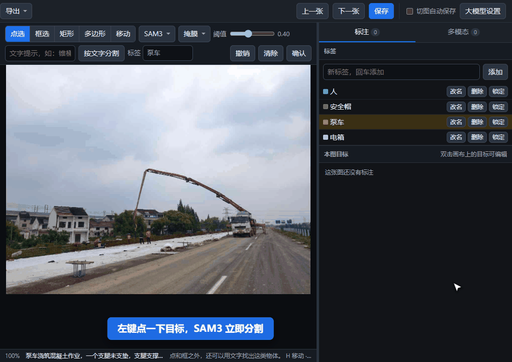
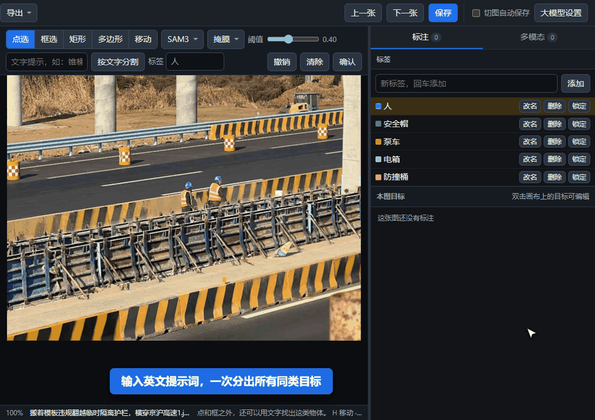
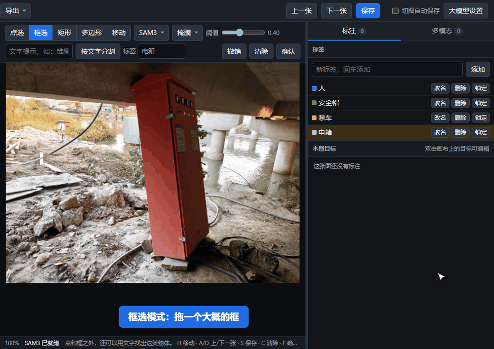
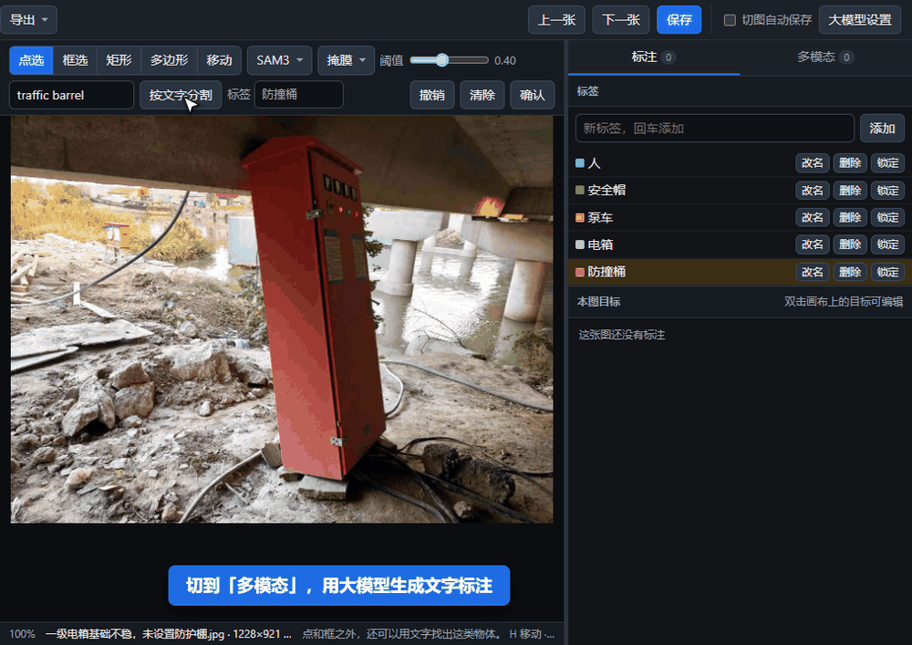

# Vismeta

**视觉 + 多模态一体化标注工具。** 同一个界面里完成两类标注：

- **CV 标注**：SAM3 点一下、框一下，或者输入英文提示词，自动分割出目标轮廓；也可以手画矩形和多边形。
- **多模态标注**：接入任意 OpenAI 兼容的多模态大模型，批量生成问答、描述、检测框，人工审核后导出成训练数据。

图片和模型都在服务器上，浏览器打开就能标；用 Docker 一条命令部署，CPU、GPU 机器都能跑。

## 演示

**点一下就分割**：左键加点、右键减点，按 `F` 确认，自动带上当前标签。



**英文提示词分割**：输入 `person`、`helmet`、`traffic barrel`，一次分出图里所有同类目标。



**框选分割**：拖一个大概的框，SAM3 自动贴合轮廓，双击目标还能微调顶点。



**多模态标注**：一键调用大模型生成文字，人工改写、通过或打回。



## 功能

| | |
|---|---|
| 分割模型 | SAM3（GPU，点 / 框 / 英文提示词）、SAM ViT-B（CPU，ONNX，点 / 框）、可导入自定义模型清单 |
| 手工标注 | 矩形、多边形；拖顶点、在边上加点、整体移动、锁定 |
| 多模态大模型 | 任意 OpenAI 兼容接口（llama.cpp、vLLM、Ollama、云端 API），可配多个；每个项目自己的提示词 |
| 提示词输出 | 整段文字 / JSON 问答 / 检测框（大模型给出的框作为候选，确认后进入 CV 标注） |
| 提示词变量 | `{labels}` 项目标签、`{shapes}` 本图已有标注、`{filename}` `{width}` `{height}` |
| 审核 | 待审 / 通过 / 打回，保留模型原稿，`Y` 一键全部通过并下一张 |
| 导入 | 本地图片、文件夹、压缩包，或服务器路径 |
| 导出 | labelme JSON、YOLO（可带图片）、多模态问答 JSONL（LLaMA-Factory 格式） |

## Docker 一键部署

### 1. 准备环境

- Ubuntu 20.04 / 22.04 / 24.04（其他 Linux 也可以）
- Docker 24+ 和 compose 插件：`curl -fsSL https://get.docker.com | sh`
- **GPU 版**另外需要 NVIDIA 驱动和 NVIDIA Container Toolkit，安装步骤见 [docs/DEPLOY.md](docs/DEPLOY.md#gpu-环境准备)

| | CPU 版 | GPU 版 |
|---|---|---|
| 分割模型 | SAM ViT-B（ONNX），点一下约 4 秒 | SAM3，点一下约 0.5 秒；也带 CPU 版 SAM |
| 英文提示词分割 | 不支持 | 支持 |
| 本地多模态大模型 | 不带，可接外部接口 | 可选，同一镜像里自带 llama-server |
| 镜像下载量 | 约 170 MB | 约 2.9 GB |

### 2. 下载代码

```bash
git clone https://github.com/wsx1q/Vismeta.git
cd Vismeta
```

### 3. 放模型权重

权重不打进镜像，放在数据目录里挂载进去（默认 `./data/models`）：

```bash
mkdir -p data/models/sam1

# SAM ViT-B 量化 ONNX（CPU、GPU 版都用，约 115 MB）
curl -L -o data/models/sam1/encoder.onnx \
  https://github.com/CVHub520/X-AnyLabeling/releases/download/v0.2.0/sam_vit_b_01ec64.encoder.quant.onnx
curl -L -o data/models/sam1/decoder.onnx \
  https://github.com/CVHub520/X-AnyLabeling/releases/download/v0.2.0/sam_vit_b_01ec64.decoder.quant.onnx
```

GPU 版再把 SAM3 权重放到 `data/models/sam3.pt`：在 Hugging Face 的 [facebook/sam3](https://huggingface.co/facebook/sam3) 页面申请访问后下载 `sam3.pt`。

没有权重也能启动，对应的模型会显示「缺权重」，手画标注和大模型功能不受影响。

### 4. 一键部署

```bash
./deploy.sh
```

脚本会自动完成：

1. 第一次运行时生成配置文件 `.env`（来自 `.env.example`）
2. 检测 GPU 容器环境：可用就部署 GPU 版，否则部署 CPU 版；也可以用 `./deploy.sh cpu`、`./deploy.sh gpu` 指定
3. GPU 版首次构建前下载 SAM3、llama.cpp 的源码到 `vendor/`（只下载一次，之后都用本地的）
4. 构建镜像、启动容器，等服务就绪后打印访问地址

```
==> 部署模式：gpu
==> 启动完成：http://192.168.1.10:8088
```

浏览器打开这个地址，新建项目、导入图片就可以开始标注。

### 5. （可选）接入多模态大模型

**方式一：GPU 版自带本地大模型。** 在 `.env` 里填好 GGUF 模型文件，再运行一次 `./deploy.sh`，会多启动一个 llama-server 容器，并自动设为默认接口：

```ini
VLM_MODEL_DIR=/data/models/Qwen3-VL-8B
VLM_MODEL=Qwen3VL-8B-Instruct-Q4_K_M.gguf
VLM_MMPROJ=mmproj-Qwen3VL-8B-Instruct-Q8_0.gguf
VLM_LORA_DIR=                 # 可选：LoRA 所在目录
VLM_LORA=                     # 可选：LoRA 文件名
VLM_ALIAS=Qwen3-VL-8B
VLM_GPU=1                     # 和 SAM3（WEB_GPU）放在不同的卡上更稳
VLM_EXTRA_ARGS=--flash-attn on
```

**方式二：接外部服务（CPU、GPU 版都可以）。** 在网页右上角「大模型设置」里添加接口地址、模型名和 Key，点「测试连接」确认即可；也可以在 `.env` 里预填：

```ini
VLM_URL=http://10.0.0.5:8000/v1
VLM_URL_MODEL=Qwen2.5-VL-7B-Instruct
VLM_API_KEY=
```

### 常用命令

```bash
./deploy.sh ps        # 查看状态
./deploy.sh logs      # 查看日志
./deploy.sh restart   # 重启
./deploy.sh down      # 停止（数据和权重不受影响）
```

修改 `.env` 后重新运行 `./deploy.sh` 即可生效；只改模型路径、接口地址时不会重新构建镜像。

### 主要配置（`.env`）

| 配置 | 默认值 | 说明 |
|---|---|---|
| `LABEL_PORT` | `8088` | 网页端口 |
| `LABEL_DATA_DIR` | `./data` | 数据目录：项目、图片、标注、大模型设置 |
| `LABEL_MODELS_DIR` | 数据目录/models | 分割模型权重目录 |
| `SAM3_WEIGHTS` / `SAM1_WEIGHTS_DIR` | `sam3.pt` / `sam1` | 权重目录里的文件名 / 子目录 |
| `WEB_GPU` / `VLM_GPU` | `0` / `0` | SAM3、本地大模型各用哪块卡 |
| `VLM_MODEL` 等 | 空 | 本地大模型，见上一节 |
| `VLM_URL` 等 | 空 | 首次启动时的默认大模型接口 |
| `CUDA_ARCHS` | `75;80;86;89;90` | 编译 llama-server 的显卡架构，只填自己的卡（如 30 系填 `86`）编译更快 |

完整说明见 [`.env.example`](.env.example) 和 [docs/DEPLOY.md](docs/DEPLOY.md)。

### 国内网络

在 `.env` 末尾的「构建镜像」一节按需打开：PyPI 镜像（`PIP_INDEX`）、Debian 镜像（`APT_MIRROR`）、NVIDIA CUDA 国内 CDN（`CUDA_APT_REPO`）、构建代理（`BUILD_PROXY`）、GitHub 加速前缀（`GITHUB_PREFIX`）。GitHub 只在第一次准备 `vendor/` 时用到。详见 [docs/DEPLOY.md](docs/DEPLOY.md#国内网络)。

## 使用

1. **项目**：首页新建项目，进入后从左上角「导入」添加图片（本地图片 / 文件夹 / 压缩包 / 服务器路径）。
2. **CV 标注**：工具栏选模式。点选、框选交给模型，红色是候选，按 `F` 确认；矩形、多边形手画。右侧「标注」页管理标签和本图目标。
3. **英文提示词**：选 SAM3 后工具栏出现文字框，输入英文类别名（如 `person`、`car`、`safety helmet`），点「按文字分割」。SAM3 只认英文。
4. **多模态**：右上角「大模型设置」配好接口和提示词，右侧「多模态」页对当前图运行，或在左侧「批量生成」后台跑整个项目。
5. **导出**：顶部「导出」。

| 快捷键 | |
|---|---|
| `A` / `D` | 上一张 / 下一张（默认切图时自动保存） |
| `S` / `Ctrl+S` | 保存框和文字 |
| `F` / `C` | 确认候选 / 清除候选 |
| `Ctrl+Z` | 撤销 |
| `Y` | 文字全部通过、保存并下一张 |
| `H` | 移动画面（`Ctrl+滚轮` 缩放） |
| 双击目标 | 编辑顶点；`Delete` 删点或删目标 |

## 目录结构

```
server.py            网页服务和接口
texts.py             大模型接入、提示词、调用和解析
catalog.py           分割模型清单
runtimes.py          ONNX / TensorRT 运行时
config.py            环境变量配置
static/index.html    前端（单文件，无构建步骤）
Dockerfile           cpu / gpu 两个构建目标
docker-compose*.yml  CPU 版 + GPU 叠加配置
deploy.sh            一键部署脚本
scripts/fetch-vendor.sh  准备 vendor/ 第三方源码
sam3.patch           SAM3 推理补丁（bfloat16 修正、显存释放）
```

## 致谢

- [SAM3](https://github.com/facebookresearch/sam3)、[Segment Anything](https://github.com/facebookresearch/segment-anything)（Meta）
- [llama.cpp](https://github.com/ggml-org/llama.cpp)
- [X-AnyLabeling](https://github.com/CVHub520/X-AnyLabeling) 提供的 SAM ONNX 权重

## 许可证

本项目以 [GPL-3.0](LICENSE) 开源。第三方代码（SAM3、llama.cpp 等）和模型权重遵循各自的许可证。

### 导入已有标注（Labelme / YOLO）

选择数据集文件夹或 zip / tar 压缩包，会连同已有标注一起导入。YOLO 支持检测框和分割多边形，自动转换为当前项目使用的 Labelme JSON。目录应包含 `images/train`、`labels/train`（以及可选的 val/test），根目录提供 `data.yaml` / `dataset.yaml` 的 `names` 列表或字典，或 `classes.txt`（每行一个类别）。同目录的图片和 TXT 也支持。缺少类别表、非法坐标或不支持的形状会报告失败，不会悄悄丢掉标注；空 TXT 作为负样本导入。

服务器部署时设置 `.env` 的 `LABEL_IMPORT_DIR=/data/migrate`，重新创建 web 容器后，在「服务器路径」直接填 `/data/migrate/datasetmix`，与服务器路径一致；旧的 `/imports/datasetmix` 仍可使用。两个入口都只读挂载同一源目录，不复制数据，也不额外占用磁盘。也可以本地选择整个数据集文件夹，或者上传压缩包。原始图片和标注不修改；同名图片导入后自动改名，并同步更新标注对应关系。标注 JSON 的 `imageData` 固定为空，不嵌入 Base64 图片；图片作为单独文件保存。旧标注在读取、保存或导出时也会清空内嵌图片内容。

### 推理内存管理

SAM3 按图片缓存特征，重复点选不再重复解码原图；检测框输出不生成原图尺寸掩膜，轮廓输出逐个展开掩膜。图像特征默认闲置 120 秒后释放，模型权重继续常驻，可用 `SAM_CACHE_IDLE_SECONDS` 调整（0 禁用）。Linux 容器默认限制分配器内存池，并间歇归还已释放的原生内存。健康接口分别返回 `sam3_vram_mb`（有效张量）和 `sam3_reserved_mb`（含分配器缓存），便于区分显存缓存与持续增长。

### 项目改名与本地拖入

在项目列表点击「改名」，或进入项目后点击顶部项目名称，即可修改名称。项目 ID、图片、标注和模型设置保持不变。

点击「导入图片 / 数据集」，把本地图片、整个数据集文件夹或 ZIP / TAR 压缩包拖入窗口；也可以点击选择文件夹。确认文件预览后点「开始导入」，窗口会显示上传进度和最终导入数量。YOLO 数据应连同 `images`、`labels` 和 `data.yaml` / `classes.txt` 一起导入。没有类别表时，在窗口内按编号从 0 开始，每行填写一个类别名称。上传临时文件也存放在数据盘的数据目录内，处理后自动清理。

服务器路径导入会显示扫描状态、实际处理张数/总数、成功和失败数量及当前文件。关闭窗口或刷新页面后，重新进入同一项目的服务器导入窗口可恢复查看后台任务进度；这不是断点续传，服务重启会终止任务，重新导入可能重复。任务结果保留一小时。

后台导入时顶部常驻显示进度入口，点击可返回对应项目的服务器导入窗口；刷新后自动恢复查看未完成任务。导入默认使用 4 个复制线程，环境变量 `IMPORT_WORKERS` 可在 1～8 之间调整。文件名统一分配，避免并发导入同名图片时覆盖；队列按线程数限制，不一次排入整个数据集。
